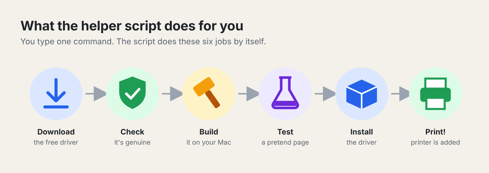
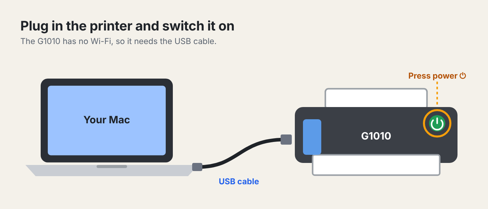
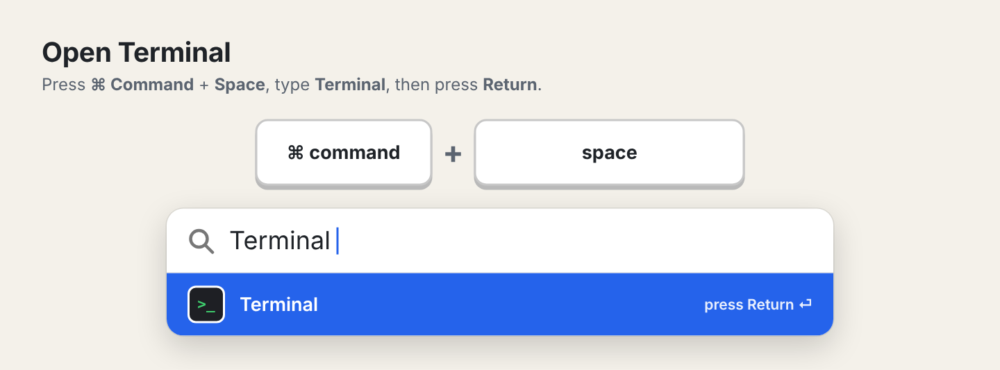
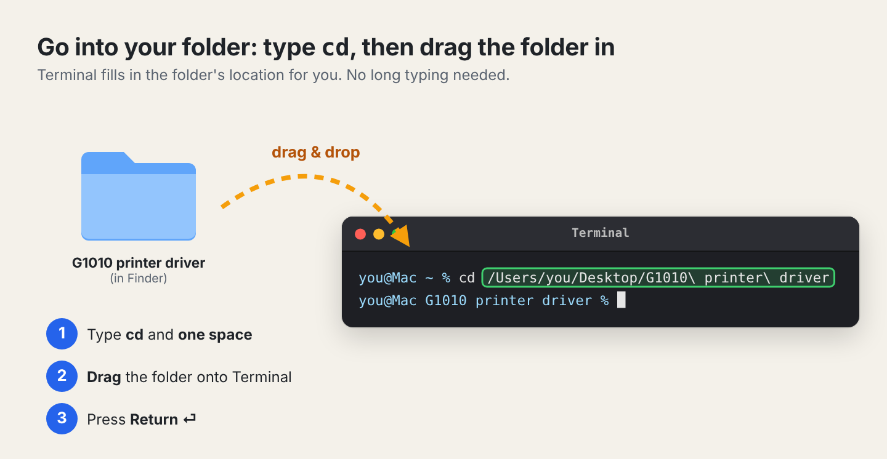
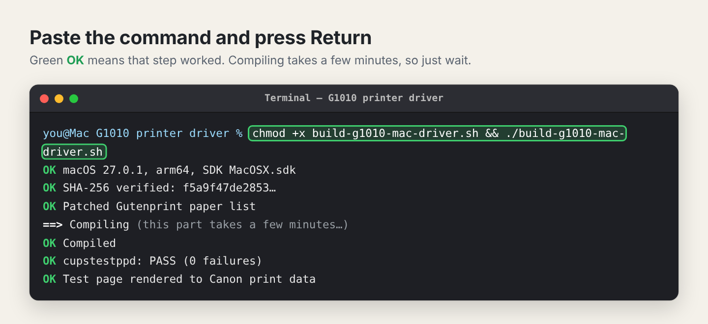
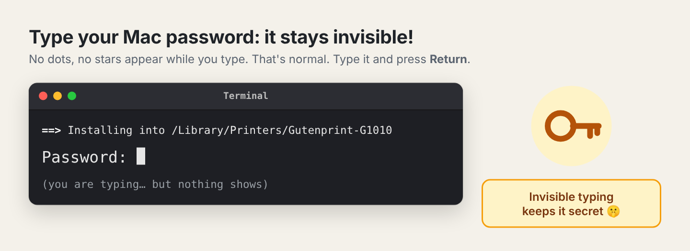
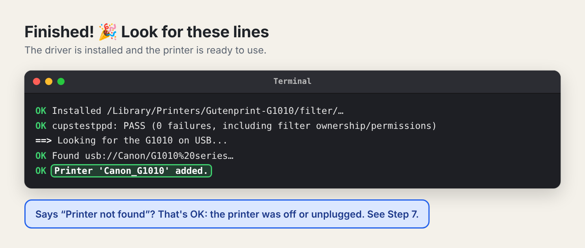
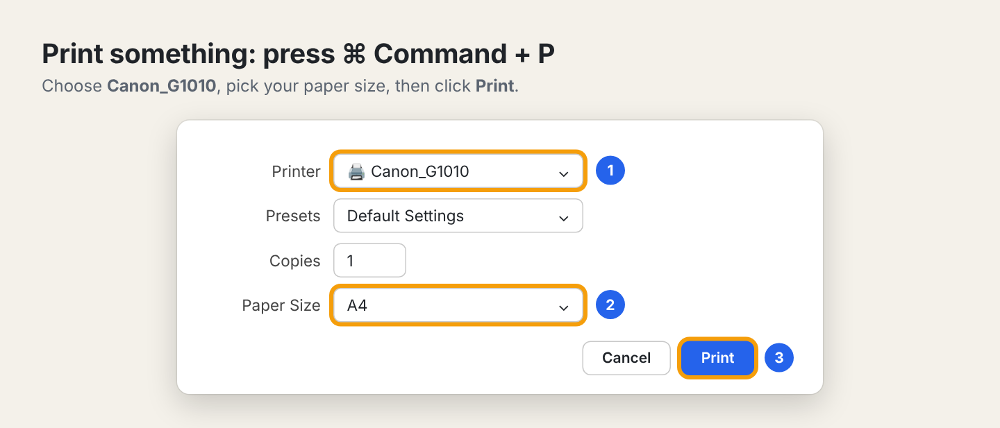
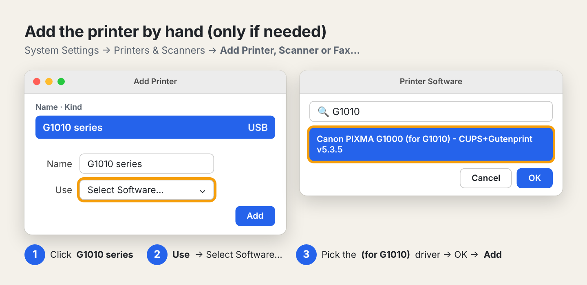

# Canon PIXMA G1010 Printer Driver for Mac

### A step-by-step guide with pictures that anyone can follow

> 🖼️ The pictures in this guide are **drawings** to show you what to look
> for. Your screen may look a little different, but the buttons and words
> will be the same.

---

## 📖 What is this?

Your **Canon PIXMA G1010** printer works with Windows computers, but Canon
never made a driver for Mac. A **driver** is a small program that teaches the
computer how to talk to the printer. Without one, your Mac doesn't know how to
print on it.

This folder gives you a free, open-source driver called **Gutenprint**, set up
for the G1010, and a **helper script** that installs it for you. You type
one command in Terminal, and the script does these six jobs by itself:



> ℹ️ The Canon Windows file (`win-g1010-…exe`) is **not used**. Windows
> drivers can't run on a Mac, so you can ignore or delete that file.

---

## ✅ Before you start: what you need

| You need | Why |
|---|---|
| A Mac with an **Apple chip** (M1, M2, M3, M4, …) running **macOS 11 or newer** | The driver is built for these Macs |
| The **Canon G1010** printer, with ink and paper | So you can print |
| The printer's **USB cable** | The G1010 has no Wi-Fi, so it must be plugged in |
| Your **Mac login password** | macOS asks for it before installing anything |

**How to check which Mac you have:** click the Apple menu in the top-left
corner of the screen → **About This Mac**. Next to **Chip** it should say
**Apple M…**.

---

## 🔌 First: connect the printer

1. Plug the USB cable into the printer and into your Mac.
   If your Mac only has the small oval USB-C ports, use a USB-C adapter.
2. Press the printer's **power button** ⏻ and wait until the light stops
   blinking.



> 💡 If you forget, don't worry. The driver still installs, and you can add
> the printer afterwards (see **"Add the printer by hand"**).

---

## 🛠️ Install the driver

You'll need an **internet connection** and about **15 minutes**. Most of
that is waiting while your Mac builds the driver.

### Step 1. Put the files in one folder

You should have these files:

- `build-g1010-mac-driver.sh` (the helper script)
- `README.md` (this guide) and the `images` folder

1. Open **Finder**.
2. Make a new folder, for example on your Desktop, called
   **`G1010 printer driver`**.
3. Move all the files into that folder.

### Step 2. Open Terminal

**Terminal** is an app where you type instructions for your Mac. Nothing to
worry about: you'll only type what this guide tells you.

1. Press **⌘ Command + Space** together. A search bar appears.
2. Type **`Terminal`**.
3. Press **Return** ⏎.



A window opens with a line ending in `%`. That's where you type.

### Step 3. Tell Terminal where your folder is

The easiest way is to **drag the folder** into Terminal:

1. In Terminal, type **`cd`** followed by **one space**. Don't press Return yet.
2. Go to **Finder** and **drag the `G1010 printer driver` folder** onto the
   Terminal window, then let go. Terminal fills in the folder's location.
3. Now press **Return** ⏎.



The line ending in `%` should now show your folder name:
`you@Mac G1010 printer driver %` ✅

### Step 4. Run the helper script

Type (or copy and paste) this line exactly, then press **Return** ⏎:

```bash
chmod +x build-g1010-mac-driver.sh && ./build-g1010-mac-driver.sh
```

**What does that mean?**
- `chmod +x …` gives the script permission to run.
- `./build-g1010-mac-driver.sh` starts the script.



Green **OK** means that step worked. ⏳ **Compiling** takes a few minutes.
That's normal, so just wait.

> **A pop-up asks to install "Command Line Tools"?** These are Apple's free
> building tools. Click **Install**, then **Agree**, and wait until it
> finishes (5 to 20 minutes). Then go back to Terminal, press the
> **↑ Up arrow** key to bring the command back, and press **Return**.

### Step 5. Type your password 🔑

When you see `Password:`, type your **Mac login password** and press **Return**.



> ⚠️ **Nothing appears while you type the password. No dots, no stars.**
> That's normal and keeps your password secret. Just type it carefully and
> press Return.

### Step 6. The finish line 🎉

Look for **"Printer 'Canon_G1010' added."** at the end:



✅ **Done!** If it says **"Printer not found"**, the printer was unplugged
or off. Go to **"➕ Add the printer by hand"**.

---

## 🖨️ Print a test page

1. Open any document, for example in **TextEdit**, **Preview** or **Pages**.
2. Press **⌘ Command + P**.
3. Next to **Printer**, choose **Canon_G1010**.
4. Next to **Paper Size**, choose **A4** (or the size of paper you loaded).
5. Click **Print**.



The printer should wake up and print. 🎉

---

## ➕ Add the printer by hand (only if needed)

Do this if the printer wasn't plugged in during the install, or doesn't
appear when you press ⌘P.

**Easiest: let the script do it** (if you have the script). Plug in and
switch on the printer, then in Terminal, inside your folder (see **Step 3**),
type:

```bash
./build-g1010-mac-driver.sh add-printer
```

**Or use System Settings:**

1. Apple menu → **System Settings** → **Printers & Scanners**.
2. Click **Add Printer, Scanner or Fax…**
3. Click **G1010 series** in the list.
4. Next to **Use**, choose **Select Software…**
5. Type **`G1010`** in the search box and pick
   **Canon PIXMA G1000 (for G1010) - CUPS+Gutenprint v5.3.5**.
6. Click **OK**, then **Add**.



> ❓ **Why does it say "G1000"?** The G1010 uses the same printing commands
> as the Canon G1000, so the G1000 driver works for it. The "(for G1010)"
> label shows it was set up for your printer.

---

## 🗑️ How to remove the driver

In Terminal, inside your folder (see **Step 3**), type:

```bash
./build-g1010-mac-driver.sh uninstall
```

Type your password when asked. This removes the printer, the driver and
everything it added. Nothing else on your Mac is touched.

---

## 🛟 Help! Something went wrong

| What you see | What it means | What to do |
|---|---|---|
| `zsh: permission denied: ./build-g1010-mac-driver.sh` | The script isn't allowed to run yet | Run `chmod +x build-g1010-mac-driver.sh` first, then try again |
| `no such file or directory` | Terminal isn't in your folder | Do **Step 3** again (type `cd`, a space, drag the folder in) |
| A pop-up about **Command Line Tools** | Apple's building tools aren't installed yet | Click **Install**, wait until it finishes, then run the command again |
| `Run this as your normal user (not with sudo)` | You typed `sudo` in front of the command | Run it **without** `sudo`. The script asks for your password itself |
| `Sorry, try again.` after typing your password | Wrong password | Type it again slowly (remember, it stays invisible) |
| `Download failed from all mirrors` | No internet, or the download site is down | Check Wi-Fi and try again later |
| `SHA-256 mismatch` or `Size mismatch` | The download was damaged or changed | The script already deleted it for safety. Just run it again |
| `Compile failed` or `configure failed` | The build hit a problem | Take a screenshot and ask for help. Also run `tail -30 ~/g1010-driver-build/logs/make.log` and screenshot that |
| `Printer not found` | Printer unplugged or off | Plug it in, switch it on, then see **"Add the printer by hand"** |
| The printer isn't listed when you press ⌘P | The printer wasn't added | See **"Add the printer by hand"** |
| Print job sits in the queue and nothing happens | Printer asleep or cable loose | Check the cable and power. In **System Settings → Printers & Scanners → Canon_G1010 → Printer Queue…**, click **Resume** ▶ if it's paused |
| Page prints but colours look odd or faded | Ink low or print head blocked | Fill the ink tanks and clean the print head with the printer's own buttons (see your Canon manual) |
| Page prints garbled (strange symbols) | The driver isn't working with this printer | See **"If it doesn't work at all"** below |

### Where are the log files?

The helper script keeps its notes in `~/g1010-driver-build/logs/` (`~` means
your home folder). If you ask someone for help, screenshots of the screen and
these logs help a lot.

---

## 🛡️ Is this safe?

Yes. The helper script was made to be careful:

- 🔒 **The driver comes only from the official Gutenprint 5.3.5**, downloaded
  over a secure HTTPS connection.
- 🧾 **The download's "fingerprint" is checked.** This is a SHA-256 checksum,
  like a seal on a jar. It must match the one published by two separate,
  trusted sources (MacPorts and NixOS). If it doesn't match, the script
  **stops and deletes the file**.
- 🧰 **Only Apple's own tools are used** to build the driver. Other software
  you may have installed (like Homebrew) is ignored.
- 🙋 **Your password is asked for only when it must be**: to copy the driver
  into the system printer folder and to add the printer.
- 🧪 **Everything is tested.** The driver "prints" a test page into a file and
  checks it, before and after installing. Apple's printer-file checker
  (`cupstestppd`) must pass with **0 failures**. If a check fails after
  installing, the script **undoes the install**.
- 📍 **It installs to just two places**, and both are removed completely by
  uninstall:
  - `/Library/Printers/Gutenprint-G1010/`
  - `/Library/Printers/PPDs/Contents/Resources/Canon-G1010-Gutenprint.ppd.gz`

---

## ⚠️ Good to know

- **This is not an official Canon driver.** Canon doesn't support the G1010
  on Mac. Gutenprint is a respected free driver used on Mac and Linux for
  many years, but Gutenprint itself calls its G-series support **"experimental"**.
- **Normal printing works:** documents, text, pictures on plain paper.
- **Colours may look a little different** from printing on Windows.
- **Ink levels and head cleaning can't be done from the Mac.** Use the
  buttons on the printer instead (see your Canon manual).
- **macOS updates:** the driver normally keeps working. If printing stops
  after a big macOS update, run the script again.

### If it doesn't work at all

If pages never print or always come out garbled, a backup plan is to run
Windows inside your Mac, with an app like **Parallels Desktop** or **UTM**.
You then connect the printer to Windows and use Canon's original Windows
driver.

---

## 📚 Words used in this guide

| Word | Meaning |
|---|---|
| **Driver** | A small program that lets the computer talk to the printer |
| **Terminal** | A Mac app where you type instructions |
| **Script** | A file of instructions the computer follows step by step |
| **Gutenprint** | A free, open-source printer driver project |
| **Build / compile** | Turning a program's written code into something the Mac can run |
| **PPD** | A small "description" file that tells macOS what the printer can do (paper sizes, quality, …) |
| **Filter** | The part of the driver that turns your page into dots of ink |
| **sudo** | Tells the Mac "do this as the administrator". It asks for your password |
| **SHA-256 / checksum** | A unique fingerprint of a file, used to prove it hasn't been changed |
| **USB** | The cable connection between the printer and your Mac |

---

## ⚡ Quick reference (for next time)

| I want to… | Do this |
|---|---|
| Build and install the driver | `./build-g1010-mac-driver.sh` |
| Add the printer | `./build-g1010-mac-driver.sh add-printer` |
| Remove the driver | `./build-g1010-mac-driver.sh uninstall` |
| See the script's built-in help | `./build-g1010-mac-driver.sh --help` |

---

*Driver: Gutenprint 5.3.5 (free software, GPL licence), built for the Canon
PIXMA G1010. Not made or supported by Canon.*

Licence: [GPL-2.0-or-later](LICENSE) · Third-party and trademark notices: [NOTICE.md](NOTICE.md)
